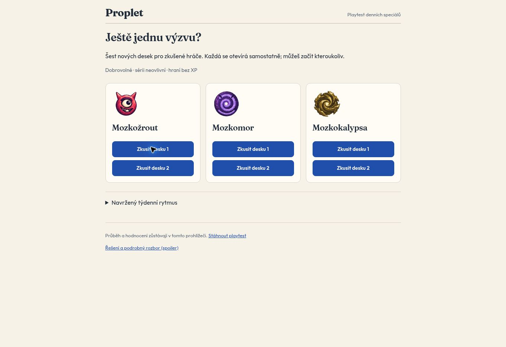

# Daily speciály · Gen6 / Lexikon v3 · 36 desek

Připraveno 11. 10. 2026. Stav: **technicky ověřeno, čeká na lidský playtest a následné schválení integrace**. Žádné datum spuštění. Žádné produkční vazby na data. PR [#192](https://github.com/prouza-hue/proplet/pull/192).

[Hratelný playtest](https://proplet-5rrsniy1g-pavel-prouzas-projects.vercel.app/) · [oddělená řešení a rozbory](https://proplet-5rrsniy1g-pavel-prouzas-projects.vercel.app/rozbor.html) · [integrační předání](INTEGRATION.md).

## Obsah

| Obtížnost | Desky | Cílová slova | Aktivní pole | Slov/desku |
|---|---:|---:|---:|---:|
| Mozkožrout / `hardcore` | 12 | 116 | 62–70 | 9–11 |
| Mozkomor / `mozkomor` | 12 | 120 | 70–75 | 10 |
| Mozkokalypsa / `mozkokalypsa` | 12 | 168 | 100 | 14 |
| Celkem | **36** | **404 různých** | | |

`bank.json` je soukromá kompletní banka včetně odpovědních cest. `schedule.json` přiřazuje stabilní ID k relativním týdnům 1–12, středa/pátek/neděle; `launchDate=null`. `validation.json` obsahuje oba řešiče, slovní původ, geometrické a zbytkové metriky každé desky, referenční banky a výběr ukázek. `editorial-review.json` eviduje tři konkrétní slovní úpravy a zbývající hráčské otázky. `geometry-selection.json` dokládá výběr pestřejších celoplošných půdorysů. `manufacture-log.json` je výrobní log před redakčními úpravami a diverzifikací; konečná autoritativní čísla jsou ve validačním reportu.

## Ověřený výchozí stav

Main i skutečná produkce: `d1f5f7825e07d7e8a1751de7075914278d3de8bb`, v4.05.5 / PR #191. Vercel deployment `dpl_5dnWAq2LzDTEivLJHhoLdXxkKE3G`, projekt `prj_0XHgnCQhdPS3pPETrxIpoXn0McMG`, tým `team_5WMqzMhPV9vWfkNAWCygaeap`. Dnešní `/api/daily` skutečně vrátil `g6-d-20261011` (Těžká), hash `a62e7782e90a7c55974756836b75362a196ef12c095140f93fd6d7ecd811a631`.

Aktivní datovaná základní banka `data/daily_gen6_private.json`: **99** desek, 8. 10. 2026 až **14. 1. 2027**, `daily-gen6-20261007-v1`, časová zóna Praha. Je to přesné přiřazení data → ID/hash, nikoli nekonečná modulo rotace. Dne 7. 10. zůstala historická deska zachována; původní záměr „100 od 7. 10.“ není skutečně nasazený stav. Hodnoty `dailyGeneration=4` a `dailyRotation=365` v obecné konfiguraci jsou kompatibilní historická metadata, nikoli důkaz aktivní banky Gen4.

Základní banku zachováváme. Důvod pro její regeneraci nebyl nalezen. Před definitivním spuštěním ověřit pokrytí celých 84 dní: například pracovní pondělní start 19. 10. končí 10. 1., zatímco start 26. 10. by už končil 17. 1. a vyžádal by malý doplněk základních Daily za konec banky. **Ani jeden příklad není nastaveným datem spuštění.**

## Rytmus

| Den | Základní Daily (stávající) | Dobrovolný speciál |
|---|---|---|
| Po | Snadná | — |
| Út | Snadná | — |
| St | Střední | Mozkožrout |
| Čt | Střední | — |
| Pá | Střední | Mozkomor |
| So | Těžká | — |
| Ne | Těžká | Mozkokalypsa |

Pevný týden zachovává srozumitelnost i stávající základní kalendář. Několikatýdenní střídání názvů obtížností nepřináší dostatečný přínos. Uvnitř Mozkokalypsy jsou týdny 4/8/12 konstrukčně výraznější a zbývajících devět tvoří hlavní sadu; nejde o další obtížnost ani naměřenou klasifikaci lidského času. V UI předem ukazovat známý týden a názvy obtížností, nikoli budoucí písmena/řešení.

## Generátor, lexikon a režim jsou různé vrstvy

Gen6 je výrobní postup využívající původní Gen5 geometrii/řešiče s úplným schváleným pracovním Lexikonem v3. Na současném mainu chybí úplná výrobní v3 sada; byla převzata **beze změny** z immutable commitu `553fb3578c958004b831068dfd268dbcb2a423ab`. Přiložený lexikon má 4 290 hesel, z toho 1 143 schválené expanze, SHA-256 `7baff6af094af0331d379050a680980e9b4f880428efd0c9ea620ce80c1fc277`. Historický ZIP není současná autorita runtime.

Nový adaptér `tools/daily_specials/` ověřuje tento hash, aktuální historii a současný recognizer. Nepouští historický FullCatalog s předstíranou shodou starého input manifestu. HC/MM přebírají své skutečné geometrické kontrakty; MK má **vlastní** plnou Hamiltonovu konstrukci a validaci propletení. Žádný profil MM pouze nepřejmenováváme na MK. Runtime generace/pořadí volné hry se nemění.

| Název | Skutečné rozlišení generátorů a bank |
|---|---|
| Snadná | Menší organická plocha; Gen5 profil 5×5, 20–24 buněk, 4–5 slov, nejvýše jedna změna směru/cestu; existují plánované 6×6 varianty. Současná banková maxima jsou širší než základní profil. |
| Střední | 7×7, 30–35 buněk a 6–7 slov v základním výrobním profilu, nejvýše dvě změny směru/cestu; více rozhodnutí bez šnečích cest. |
| Těžká | 9×9, 50–56 buněk, 8–9 slov, průměr změn směru 1,8–3,35, každá cesta alespoň jeden obrat, omezené dlouhé rovné úseky. |
| Mozkožrout | 10×10, 62–72 buněk, 9–11 slov, delší/zakroucené cesty; průměr 2,35–4,6, zakřivených alespoň 52 %, limit souvislého curlu 4 a počtu curlových cest 7, nepravidelná maska. |
| Mozkomor | 10×10, výrobní profil 70–76 buněk, 10–11 slov, 5–10 písmen; průměr změn směru 4,5–6, zakřivených alespoň 85 %, průměr rovných úseků nejvýše 0,4, curl run nejvýše 4. Finální nasazená historická banka používá i 80 buněk a kalibraci `mozkomor-human-v40132`; ne všechny historické desky splňují tento pozdější výrobní profil. |
| Mozkokalypsa | Všech 100 buněk, 14 slov, délky 5×1/6×3/7×4/8×5/9×1. Každá cesta alespoň 2 obraty (silnější sada alespoň 3), průměr hlavní sady alespoň 54/14; mezislovní sousedství ≥74, návraty cest do řádku/sloupce ≥4, alespoň dva sousedé/cestu, průměr sousedů ≥52/14, alespoň dvě cesty přes každý vnitřní řez. Silnější konstrukce vyžaduje ≥66 obratů dohromady a přísnější propletení. |

Úplné numerické profily tohoto batche jsou v `manufacture-log.json`. Odlišnost není jen rozměr, počet slov či C tier. MK může mít méně obratů na jedno slovo než MM a přesto více celkové práce, plné pokrytí a provázané rozhodování.

Lexikon: pouze `target_eligible=true`, explicitní vyloučení a schválená hesla; bez přebírání slabé automatické v2 vrstvy. Nová sada používá A/B/C (**103/192/109**), žádné D, nové slovo nevzniklo. Zachované tvarosloví a variantní jednotky; uznávané bonusové slovo není automaticky cílově přípustné. Edition-specific HŘEBELEC/SOFTWARE/NINJA/EROTOMAN/FIREWALL jsou vynechány; nejde o globální zákaz rozpoznávání. Některé známé přejímky autorizovaného lexikonu zůstávají. Obtížnost je konstruována cestami, klamným větvením a propletením, nikoli zvyšováním neznámosti cílových slov.

Režim: Daily/special určuje datum, odměnu, sérii a pořadí; obtížnost určuje obsah desky. Označení `meta.contentGeneration=6` nepovoluje výsledkové klíče ani nemění ekonomiku aplikace. Současný server novou banku nijak nenačítá.

## Výsledek kontroly

- 36/36 projde strukturou: přesný pravopis včetně diakritiky, ortogonální jednoduché cesty, žádné sdílené pole, všechny aktivní buňky právě jednou, správné délky, souvislá maska, žádné zřetězení konec→začátek jiné odpovědi.
- 36/36 má jediné úplné řešení a jedinou cestu každého cílového slova. Výrobní trie + MRV exact-cover a nezávislé prefix-set hledání + first-cell exact-cover souhlasí i v počtu kandidátů; druhý kontroluje shodu celého řešení s odpověďmi. Limit/timeout je odmítnutí, nikoli „asi unikátní“.
- Kontrola používá celý zmrazený soubor **103 836** uznávaných slov, hash `eaf808cd425024e1f84df62498abb8f7de9a39257b70dc0d069ac6f4d0cd05c1`, nikoli pouze cíle nebo malý slovník. Arbitrární budoucí frekvenční fallback nelze touto konečnou množinou dokazovat.
- Nula opakovaných cílových slov či ortografických variant uvnitř 36; nula cílových překryvů se všemi 99 základními Daily. Nula shodných desek (i rotace/zrcadlení) nebo celých sad slov proti **3 267 odlišným obsahům z 18 dostupných bankových souborů**. Seznam i hashe vstupů jsou v reportu: runtime/canonical/free refresh/MK100, rolling, historické Daily Gen1/2, všechny tři MK piloty, Gen4/5 kandidáti a Tajenky. Nejde o tvrzení, že byly porovnány všechny soukromé větve či osobní herní historie.
- 404 cílů z 21 tematických oblastí. 374 slov se v jiné dostupné bankovní historii již někdy vyskytlo, 30 je vůči těmto souborům nové. Kontrola duplicit desek není příslib, že žádný hráč slovo nikdy neviděl. Morfologicky blízké rodiny mohou mít dvě různá hesla napříč týdny; nejde o ortografické varianty či opakované slovo.
- MK půdorysy jsou navzájem pestré: maximálně šest shodných celých word-cell setů z 14 při porovnání všech osmi symetrií. Žádný celý MK půdorys není kopií dostupné historické celoplošné desky. Ostatní vrstvy strukturální pestrost doplňují organickými maskami, proměnlivými délkami a pořadím odpovědí.

| Mediány · nové / aktuálně nasazená volná banka stejné obtížnosti | Mozkožrout | Mozkomor | Mozkokalypsa |
|---|---:|---:|---:|
| Změny směru na slovo | 4,56 / 4,10 | 4,80 / 4,90 | 4,00 / 3,86 |
| Statické klamné prefixové větvení | 39,43 / 36,87 | 44,48 / 47,81 | 53,88 / 57,30 |

Benchmark byl přepočten stejnou prefixovou množinou pro nové i stávající desky. MK zbytek po polovině slov: medián 31,93 vs. 33,23; poslední tři: 18,83 vs. 19,92. **Nevydáváme to za vyřešení snadného endgame.** Předchozí kolo III přineslo lepší celkový zážitek, ale poslední trojice zrychlovala. Tyto statické proxy slouží k výběru a kontrole konstrukce, nenahrazují lidské hodnocení ani čas. Zdroj zkušeností: `docs/mk100-recovery/evaluations/MOZKOKALYPSA-ROUND3-EVALUATION-20261001.md` ve větvi `docs/mk100-recovery-20261001`.

## Playtest a ověření aplikace

| Obtížnost | Deska 1 · typická v nové sadě | Deska 2 · náročnější konstrukce |
|---|---|---|
| Mozkožrout | `g6-ds-hardcore-w06` | `g6-ds-hardcore-w07` |
| Mozkomor | `g6-ds-mozkomor-w12` | `g6-ds-mozkomor-w05` |
| Mozkokalypsa | `g6-ds-mozkokalypsa-w01` | `g6-ds-mozkokalypsa-w12` |

Výběr kombinuje relativní pořadí geometrie, počátečního větvení a zbytků; MK náročnější reprezentuje jednu ze tří výraznějších plných konstrukcí. Nálepky nejsou před hraním zobrazené, řešení jsou až na oddělené spoilerové stránce. Zabránit pořadovému efektu: část testerů nejdřív 1, část nejdřív 2; střídat i pořadí obtížností. Cílem jsou náročnost/zábavnost 1–5, neznámá či rušivá slova, nápovědy a tempo posledních tří nálezů. Export JSON obsahuje průběh nálezů i hodnocení; nic automaticky neodesílá.

Preview používá původní `public/app/game/board.js` a `input.js`, původní tři ikony, Outfit/Fraunces a Tiskařskou dílnu. Vlastní lokální namespace obsahuje ID i obsahový hash. Nemá účet, XP, veřejné výsledky ani Supabase klienta. Na web jde pouze šest ukázek; úplná banka/kalendář mimo static root. Stav Vercelu READY, target null (=preview), Git SHA `e6d836db9bff5195f6c00b76bce1e70e4d60e8de`, deployment `dpl_CziE7kySVJ8K3W4NjvFpXRRyqyZb`. Kořenové `vercel.json` ani project settings produkce nejsou změněny; pouze deployment-specific root `preview/daily-specials`.

[CI 38160948220](https://github.com/prouza-hue/proplet/actions/runs/38160948220): oba řešiči 36/36 a skutečné tahy **12/12** (všech šest myší při 1280px i dotykem při 390px); obnova po reloadu, undo, pauza, dokončení celé plochy, uložení zpětné vazby, chybné cesty, nápověda a oddělené spoilery. Žádné JS chyby, externí požadavky ani zapisující HTTP metody v preview. Artifact obsahuje report a snímky. Current runtime gate stejného commitu prošel. Live `/boards.json` odpovídá vybraným šesti bitově po parsování; private bank a `/api/daily` mají 404. Nasazené preview bylo také vizuálně otevřeno v prohlížeči. Toto je automatická/funkční QA, **nikoli dokončený lidský playtest**.

## Reprodukce

Python 3.12, g++ C++17; bez síťového přístupu či DB. Ověření připravené banky:

```bash
python -m unittest tools.daily_specials.test_validation
python -m tools.daily_specials.verify
python -m tools.daily_specials.build_preview
```

Nová výroba do prázdného checkpointu: `python -m tools.daily_specials.manufacture --seconds 900`, potom `python -m tools.daily_specials.diversify_full`, `python -m tools.daily_specials.editorial`, `verify`, `build_preview`. Při opakování z existující finální banky manufacture pouze obnoví centrální slovní ledger; nepřevyrábí schválené cesty. Zachované seeded geometry pools a záznam redakčních výměn umožňují sledovat jednotlivé fáze. Nový input hash či změněný recognizer znamená zastavení a nový baseline, ne automatické schválení publikace.

Pro browser QA: Playwright 1.57, Chrome, `PROPLET_PREVIEW_ORIGIN` případně nastavit na izolované preview, spustit `node preview/daily-specials/qa.cjs`. Automatické známky jsou výslovně označené a nesmějí být použity jako hráčský feedback. CI nepoužívá produkční credentials.

## Hotovo / čeká

**Hotovo:** banka, šest ukázek, podpora a dva validátory vyšších obtížností, lexikální/strukturální kontrola, relativní rozvrh, oddělený statický playtest, dokumentované integrační změny. **Čeká:** lidský playtest, finální ekonomické a archivační volby, implementace nového výsledkového kontraktu a UI Dnes, Supabase migrace, datum spuštění a produkční schválení. PR je obsahová příprava; sloučení není pokyn k aktivaci speciálů.

## Vizuální doklad


