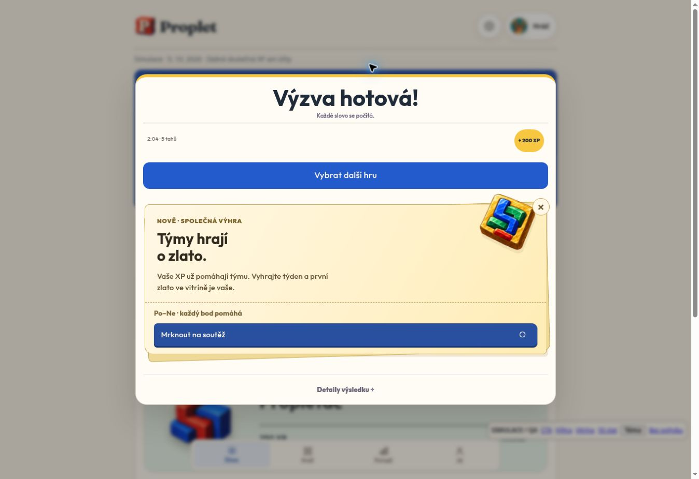

# Weekly team victories — deployment verification

Verified 27 September 2026, approximately 22:26 Europe/Prague.

- Production: https://hrajproplet.cz/
- PR: https://github.com/prouza-hue/proplet/pull/151
- Tested feature head: 303d16f1161a9b031927847179816742e8c956bd
- Production merge: 4d20c9a405a8c78b2b8531487e3b7af162b97a6b
- Vercel deployment: dpl_6guzhejhtwT54zpcszkU15fksCAV, READY, production target.
- API response header confirms 4.03.0.
- Supabase migrations weekly_team_victories and weekly_team_victories_scheduler applied successfully.
- Settings enabled=true; launch_date=2026-09-28.
- Named active cron: proplet-weekly-team-victories, 10 * * * *, owned by postgres.
- Production finalizer launch guard returned enabled=true, finalized=0. Ledger: zero awards, zero rounds.
- Service-role state read confirmed eligible public team, zero gold, empty history and no pre-launch intro.
- Missing authentication returns HTTP401 on production; preview returns enabled=false before authentication.
- All five tables have RLS enabled and no anon/authenticated SELECT grants. Backend has no DELETE permission.
- Functions are invoker functions with fixed empty search_path; browser roles cannot execute.
- Security advisor reports intentional no-policy RLS on these server-only tables; this is the deny-by-default design.

## Checks
All applicable pre-merge checks passed at the tested head:
current-runtime; isolated-result-database; isolated-weekly-victories; version-alignment;
browser (onboarding/activation); printshop-ui (layout/account/idle/offline); gen4-contract.

Weekly gate: 9 authenticated HTTP boundary tests, 4 frontend identity/receipt tests,
17 real PostgreSQL17.11 behavioral cases. Full database gate also installed real
pg_cron and verified named registration, migration retry, actual background execution
of the disabled finalizer, and removal of its synthetic-only probe. No test data or
probe scheduler was created in production.

Browser checks used the actual new module and current Proplet shell with in-memory
fixtures on a separate QA branch: widths360/390/768/1280; light/dark; reduced motion;
intro after result; Continue clears intro; CTA opens weekly team ranking; cabinet;
50-gold LegendII and next75 milestone; Escape closes ceremony; ordinary entry has
no new card/dialog. Production guest entry also has no new card/dialog.

The attached image is an isolated QA illustration, not an actual player's award:

## First real weekly closure
The first full week is 28 September–4 October2026. Scheduled first closure is
5 October2026 00:10 Europe/Prague. This future production awarding run has not yet
occurred; its behavior is covered by isolated SQL and scheduler tests.

Rollback: set public.team_victory_settings.enabled=false; retain immutable awards.
